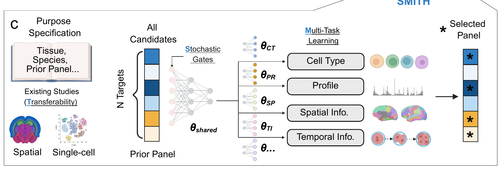

<p align="center">
  
</p>

<p align="center">
  <strong>Agentic and Transferable Panel Design</strong><br>
  Imaging-based spatial molecular profiling with compact panels that preserve the biological signals your assay needs.
</p>

<p align="center">
  <a href="https://smith-panel-design.readthedocs.io/en/latest/">Documentation</a> ·
  <a href="https://smith-panel-design.readthedocs.io/en/latest/tutorials/index.html">Tutorials</a> ·
  <a href="https://github.com/fym0503/SMITH/issues">Issues</a>
</p>

---

SMITH learns a compact set of genes or molecular targets from single-cell, spatial or aligned reference data. Its multi-task objective can preserve cell identity, expression profiles, spatial organization and developmental signals; SMITH-Agent adds reference-aware workflow tools for panel design and evaluation.

## Why SMITH?

Imaging-based spatial assays measure a limited number of molecular targets. Designing a useful panel therefore requires choosing which biological signals to preserve, which reference data to learn from, and how to evaluate the selected targets.

| Panel-design challenge | How SMITH helps |
|---|---|
| A limited panel must preserve the biological differences of interest | Selects targets using objectives such as cell identity, expression reconstruction and developmental timing |
| Spatial patterns matter alongside molecular profiles | Incorporates spatial coordinates and cell annotations into panel selection |
| Reference data and the intended assay may come from different studies or modalities | Learns panels from related references and evaluates their performance in the target dataset |
| Panel design involves multiple data sources and analysis steps | SMITH-Agent connects data inspection, reference integration, panel selection and evaluation |

<p align="center">
  <a href="docs/source/_static/figures/smith_framework.png">
    
  </a>
</p>

## Install

SMITH requires Python 3.10 or newer.

```bash
git clone https://github.com/fym0503/SMITH.git
cd SMITH
python -m pip install --upgrade pip
python -m pip install -e .
```

For notebooks and plotting, install the notebook dependencies too:

```bash
python -m pip install -e '.[notebooks]'
```

## Quick start

Prepare an AnnData `.h5ad` file with targets in `adata.var_names`. For a cell-type task, include cell labels in `adata.obs['celltype']` (or `cell_type` or `subclass`). Then run:

```bash
python scripts/main.py \
  --adata_file data/your_reference.h5ad \
  --saving_dir outputs/my_panel \
  --log_dir outputs/my_panel/logs \
  --tasks recon,cls \
  --task_name celltype \
  --panel_size 64 \
  --epoch 100 \
  --device cpu
```

Set `--device cuda` to train on a CUDA-enabled GPU. The run writes ranked targets and training logs under the output directories.

### Add spatial information

If the AnnData object stores coordinates in `adata.obsm['spatial']`, add the spatial objective:

```bash
--tasks recon,cls,coordination
```

Use `--layer counts` to train from a named AnnData layer rather than `adata.X`.

## SMITH-Agent

Start an interactive session with `smith-agent`, or inspect the packaged registries:

```bash
smith-agent tools
smith-agent datasets
smith-agent models
smith-agent
```

To use configuration files from a source checkout, pass the registry explicitly:

```bash
smith-cli --config configs/agent/agent.yaml tools
smith-cli --config configs/agent/agent.yaml shell
```

For natural-language planning, set your OpenAI model and API key before starting the shell:

```bash
export OPENAI_MODEL="your-model-id"
read -r -s -p "API key: " OPENAI_API_KEY
export OPENAI_API_KEY
smith-agent
```

Replace `your-model-id` with the OpenAI model you want to use.

Use `/help`, `/models`, `/tools` and `/status` to inspect the session. Enter `@/absolute/path/to/input.h5ad` to mount your data. Dataset registry entries need their corresponding H5AD files; probe-design tools also need their external backends and reference indexes. See [`configs/agent/`](configs/agent/) for registry entries.

The shell and explicit `smith-agent run-tool` commands work without a language model. `smith-cli` is an alias for the same entry point.

## Tutorials

`TF_profile`, `ribomap_profile` and `Agent_profile` configure the same SMITH implementation for their respective tasks. The CLI, Agent and notebooks share the trainer in `src/smith/train.py`.

The tutorial notebooks walk through three biological settings:

| Notebook | Example |
|---|---|
| `02_SMITH_Regulatory_Activity` | TF activity in *C. elegans* |
| `03_SMITH_RIBOMap_Transfer` | Transfer from Deep-RIBOmap and STARmap into RIBOMap |
| `05_SMITH_Agent_Evaluation` | Liver panel design with spatial references and MERFISH evaluation |

Read the [rendered tutorials](https://smith-panel-design.readthedocs.io/en/latest/tutorials/index.html), or run the `_source.ipynb` files locally.

Download the complete data bundle from [Zenodo](https://doi.org/10.5281/zenodo.24137308) (7.10 GB download; about 11.2 GB of input data). One download supplies all three tutorials, including the five TF lineage splits and five liver spatial references.

From the SMITH repository root, run:

```bash
python scripts/download_tutorial_data.py --data-root data/tutorials
export SMITH_TUTORIAL_DATA="$PWD/data/tutorials"
jupyter lab docs/source/tutorials/notebooks
```

The script verifies the archive SHA-256, extracts the inputs into `data/tutorials/`, and checks each input file. Allow about 20 GB of free disk space for the archive and extracted data, plus space for training outputs.

If you already downloaded the archive, add `--archive /path/to/SMITH_tutorial_complete_20261110.tar.gz` to the download command. If you extracted it manually, set `SMITH_TUTORIAL_DATA` to the extracted `SMITH_tutorial_complete/` directory. Keep its `regulatory_activity/`, `ribomap_transfer/` and `agent/` subdirectories together.

## Reproduce paper analyses

List the packaged workflows and check whether their input data are available locally:

```bash
smith-repro list
smith-repro check
```

Run a workflow after its required data are in place:

```bash
smith-repro run 03_ribomap_transfer --data-root data/tutorials
```

Each workflow writes panels, metrics and a run manifest to its output directory. See [`reproducibility/`](reproducibility/) for workflow definitions and data requirements.

## AnnData fields

| Objective | Required data |
|---|---|
| `recon` | Expression matrix in `adata.X`, or the layer selected with `--layer` |
| `cls` | Cell labels in `adata.obs['celltype']`, `cell_type` or `subclass` |
| `region` | Region labels in `adata.obs['region']` |
| `pathology` | Labels in `adata.obs['pathology']` |
| `coordination` | Coordinates in `adata.obsm['spatial']` |
| Developmental time | Numeric time labels in the column specified by `--time_label` |

Optional prior targets can be supplied with `--prior_file`, a CSV containing a `names` column that matches `adata.var_names`.

## Repository map

```text
src/smith/          Core panel-selection model
src/smith_agent/    Agent workflow and command-line interface
configs/            Dataset, model, tool and workflow registries
scripts/            Training, evaluation and data utilities
docs/               Tutorials and API documentation
reproducibility/    Paper workflows, manifests and reference metrics
tests/              Package and workflow tests
```

## Development

Install the test dependencies and run the suite:

```bash
python -m pip install -e '.[dev]'
python -m pytest
```

Build the source and wheel distributions with:

```bash
python -m pip install build
python -m build
```
